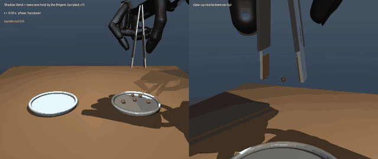

# robothand-sim: 5本指ハンド＋ピンセットによる豆の移し替え（MuJoCo）

5本指ロボットハンドがピンセットを持ち、皿Aの炒り豆を1粒ずつ皿Bへ移すシミュレーションです。
第1回GMOロボットハンドコンテストの課題（5本指ハンド・ピンセットまたは箸・5分間で何粒移せるか）を、実機開発に入る前にシミュレーションで再現しました。



## 現在できること

| | 内容 | 成功率（開発に使っていない配置） |
|---|---|---|
| 1 | Shadow Hand が**ピンセットを指だけで持ち**（ホルダーなし）、豆を連続して移す | 250/250 = 100%（1粒 4.35 秒） |
| 2 | コンテストの貸与機 **G1-D に対応する五指ハンド BrainCo Revo 2** で同じ作業をする（ピンセットは掌のホルダーに固定） | 248/250 = 99% |
| 3 | スクリプト制御で集めたデモから **Diffusion Policy を模倣学習**し、学習した方策で豆を移す（Shadow Hand・ホルダー） | 249/250 = 100%（1粒 4.14 秒） |

- 指の腹とピンセットの接触力を触覚センサーの代わりに使い、親指と人差し指の把持力をそれぞれ目標値に合わせる
- 指だけで持つときは、ピンセットの姿勢（道具の追跡）から手の中の転がりと横ずれを検出し、指で持ち直す
- 豆の配置・大きさのばらつき・位置認識の誤差・先端の摩擦係数・動作速度を変えて、成功率と速度を測る
- 評価・デモ収集・学習は、Kaggle のカーネル上で並列に実行できる（`kaggle/remote.py`）

## 結果

数値はすべて、開発中に一度も使っていない豆の配置で測りました。1つの配置につき豆5粒を続けて移します（長時間テストは10粒）。括弧内は成功率の95%信頼区間です。

### ハンド・持ち方・速度ごとの成功率

| ハンド | ピンセットの持ち方 | 1× | 1.5× | 2× | 3× |
|---|---|---|---|---|---|
| Shadow Hand | 掌のホルダーに固定 | 248/250 = 99%（97〜100%） | — | 100% | 98% |
| Shadow Hand | **指だけで持つ** | **250/250 = 100%（98〜100%）** | 80% | 22% | 8% |
| BrainCo Revo 2（G1-D 用） | 掌のホルダーに固定 | **248/250 = 99%（97〜100%）** | — | 69% | 18% |

- 1倍速で1粒 4.35 秒、5分間に換算すると約 68〜69 粒です（2倍速は 2.18 秒、3倍速は 1.45 秒）。
- 指だけで持つ場合も、1倍速ならホルダーと同じ成功率です。10粒を続けて移す長時間テストでも 100/100 でした。手の中でのピンセットのずれは中央値 8 mm・6°、最大 10 mm・9° で、持ち直しの制御によって増え続けません。
- 指だけで持つと、速くした時に失敗が増えます。腕の加減速でピンセットが手の中で大きく滑り、つかみ損ねるか落とします。速さを出すには、保持の仕方（中指で支える三点持ちなど）の改良が必要です。
- Revo 2 は、Shadow Hand 用に作った制御をそのまま使っています。ピンチ姿勢と関節の使い方は、モデルから自動で求めました（下記）。2倍速以上で成功率が下がる原因（豆を持ち上げたあとに落とす）はまだ調べていません。

### 豆の位置の認識誤差（Shadow Hand・ホルダー）

水平2軸それぞれに、標準偏差 σ のガウス誤差を加えました。各条件 100 回です。

| σ | 1× | 3× |
|---|---|---|
| 0 mm | 100% | 98% |
| 1 mm | 100% | 99% |
| 2 mm | 98% | 96% |
| 3 mm | 91% | 86% |

画像から豆を検出するときの目標精度は、σ 2 mm 以内が目安です。

### ピンセット先端の摩擦係数（Shadow Hand・ホルダー・3倍速）

摩擦係数 0.1〜0.8 のどれでも成功率は 98/100 で、結果は完全に同じでした（0.03 以下にすると失敗します）。
このシミュレーションでは豆を硬い球とし、把持力に十分な余裕があるため、摩擦係数 0.1 以上では差が出ません。
先端の材料（柔らかさ・接触面積・豆の表面のばらつき）の効果はこのモデルでは表現できないので、材料の工夫の根拠は実物の試験で示す必要があります。

### 模倣学習（Diffusion Policy）

学習の流れ（デモ収集 → 学習 → 閉ループ評価）を、Shadow Hand・ホルダー方式で一通り動かしました（[動画](docs/media/learned_policy_holder_x1.mp4)）。

| 制御 | 成功率（配置 50 × 豆5粒） | 1粒あたり |
|---|---|---|
| 学習した方策（Diffusion Policy） | **249/250 = 100%** | 4.14 秒 |
| スクリプト制御（同じ配置・同じ 20 Hz の窓口） | 246/250 = 98% | 4.10 秒 |

- **窓口：** 方策は 50 ms ごとに「次の先端の目標位置」と「開く／閉じる」を出す。指の力制御などの低レベル制御はスクリプト制御と共通（`env.py`）。
- **観測：** 17 次元。先端の位置と速度、狙う豆と置き場所の相対位置、指の腹の力、葉の開き、直前の開閉指令。画像はまだ使っていない。
- **データ：** スクリプト制御で 240 エピソードを集め、全粒成功した 153 エピソード（約 6.3 万サンプル）で学習した。
- **モデル：** 残差 MLP の雑音予測器（222 万パラメータ）。直近2時点の観測から 0.8 秒分（16 ステップ）の行動を予測し、そのうち8ステップを実行して予測し直す。学習は DDPM、推論は DDIM の 10 ステップ。Kaggle の T4 GPU で約 3 分。
- **評価：** 学習にも開発にも使っていない配置（シード 500〜549）で測った。
- **位置づけ：** 学習した方策はスクリプト制御を真似ているので、現時点ではスクリプト制御より速くはならない。この節で示したのは、データ収集から学習・評価までの流れが動き、方策がシミュレーション上で作業をやり切れること。速さで上回るには、より速いデモ（遠隔操作など）や画像入力が必要になる。

条件ごとの全データは [docs/results/](docs/results/) にあります。

## シミュレーションの構成

| 要素 | モデル化 |
|---|---|
| ハンド（1） | Shadow Hand E3M5 右手（MuJoCo Menagerie、20アクチュエータ）。中指・薬指・小指は握り込み、親指と人差し指でピンセットを操作 |
| ハンド（2） | BrainCo Revo 2 右手（公式 MJCF、関節11・能動6）。公式モデルにはアクチュエータも関節の連動も入っていないので、位置サーボ6個と、遠位関節を近位関節に連動させる拘束（親指 ×1.0、四指 ×1.155）を追加した |
| 腕 | 3軸の直動ガントリー（位置サーボに速度・加速度のフィードフォワードを加える）。手首は固定 |
| ピンセット | 長さ125 mm。2枚の葉をそれぞれバネ付きヒンジで開く方向に支え、先端内側に摩擦パッド（16 mm）を付けた。ホルダー方式では根元を掌に固定。指だけで持つ方式では自由な物体で、指の腹が当たる区間の幅を 16 mm に広げた（実物のグリップ部に相当） |
| 豆 | 直径 8 mm ±1 mm の球、0.25 g 前後 |
| 皿 | 半径 50 mm、縁を一段高くした浅皿 |

ピンセットの位置と向きは、ハンドの「親指と人差し指のピンチ姿勢」で両指の先が接する点とその法線から、モデル構築時に自動で計算します（`scene.calibrate_pinch`）。
Revo 2 では、ピンチ姿勢を関節空間の格子探索で求めます。条件は、指の腹同士が接し、指の根元側が相手の指に 2 mm 以上近づかないことです。開閉の方向（親指を人差し指に近づける動き、葉の幅方向にずらす動き）は、ピンセット座標での指の腹のヤコビアンから計算します（`hands.py`、`scene.fit_mixes`）。

## 制御

### 1粒の手順

次の段階を最小躍度軌道でつなぎます。

1. 豆の上へ移動
2. 下降（先端を豆の赤道より少し下へ。ただし皿面から 1.2 mm 以上離す）
3. 閉じる・保持
4. 持ち上げる
5. 皿Bの上へ運ぶ
6. 下ろす
7. 開いて離す
8. 退避

### 指の制御（ホルダー方式）

閉じる動作は、指ごとに次の3段階で行います（ガード付き移動）。

1. 葉の先端が中心線から 7.5 mm より外にある間は、80 mm/s で速く閉じる
2. それより内側では 20 mm/s に落とす（先に触れた葉が軽い豆を弾き飛ばさないように）
3. 指の腹が葉に触れたら（0.03 N 以上）、指の腹から葉に加わる法線力を 0.25 N に保つ積分制御に切り替える

### 指だけでピンセットを持つ

ホルダーがないので、ピンセットを手に保つのは指の腹の接触だけです。実物のピンセットと同じく、葉のバネが常に指の腹を押し返すので、開いているときも指で挟む力（0.25 N）が残ります。豆をつまむときは 0.6 N に上げます。

1. **受け渡し：** ピンセットと葉を名目の姿勢に固定したまま指を葉に当て、葉を解放し、最後にピンセットを解放する。いきなり離すと、指の当たり方の偏りでピンセットが弾き出された。
2. **持ち直し：** 指の腹の接触点が葉の幅方向で約 3 mm ずれていて、強く挟むほどピンセットが長軸まわりに転がる（10〜20°）。また、両指を力だけで制御すると、横方向の位置を決めるものがない。そこでピンセットの姿勢（道具の追跡で測れる前提）から次の2つを返す。
   - 転がりの分だけ、親指の腹を葉の幅方向にずらす
   - 横ずれの分だけ、両指を同じ向きに動かす
   これが無いと3粒目前後で落とし、あると10粒続けても滑りが 10 mm 程度で止まる。
3. **先端位置の補正：** ピンセットは手の中で少し動くので、腕の目標は先端の実測位置で補正する。補正量には上限 3 cm を設け、落ちかけた工具を腕が追いかけないようにした。

## 開発中に分かったこと（シミュレーション上の落とし穴）

実機に進む前に知っておく価値がある内容なので、記録しておきます。

1. **mocap（運動学的に位置を指定する物体）でハンドを動かすと、豆を持ち上げられない。** mocap は毎ステップ瞬間移動するため速度を持たず、接触の摩擦（速度レベルの拘束）が働かない。腕を直動関節と位置サーボに置き換えて解決した。
2. **軽い物体はソフト接触に沈み込む。** MuJoCo の拘束の正則化はおよそ 1/質量 に比例するため、0.25 g の豆を約 1 N で挟むと、既定の接触パラメータでは葉が豆を貫通する。豆とパッドの接触を、ほぼ剛体の設定（`solimp` の dmax=0.9999）にした。
3. **腱で結合された指関節の初期値の分け方で、指先の位置が変わる。** 実機と同じく中関節が先に曲がる規則にした。
4. **小さい豆では、先端の角が皿に当たる。** 皿面からの最小間隔を追加した。
5. **速くすると、閉じる動作・手首・腕の推力が追いつかない。** 接触前は一定速度で閉じる、手首を固定する、腕の推力上限を 1000 N にする、で解決した（実機の腕の能力は未確認）。
6. **自由に動く工具を受け渡すとき、工具の一部が手に食い込んでいると、工具が弾き出される。** ピンセットの根元のブロックが掌に食い込んでいて、その反発で毎ステップ工具が押されていた。根元と手の接触を外した。
7. **グリップ部の位置はハンドの大きさに合わせる必要がある。** Revo 2 はヒンジから指の腹までが 40 mm（Shadow Hand は 80 mm）で、Shadow 用の位置では指の腹がグリップ部に一度も触れなかった。
8. **学習用のデータでは、指令に入れたノイズが皿への食い込みを起こす。** 先端の高さに安全下限（皿面＋1.2 mm）を設けた。下限が無いと、0.7 mm のノイズでも成功率が 100% から 3% に落ちた。

## 実行方法

```bash
# 依存（Python 3.12、MuJoCo 3.15）。uv を使う場合
uv sync
uv run python scripts/fetch_models.py        # Shadow Hand と Revo 2 のモデルを third_party/ に取得

uv run python scripts/transfer_beans.py -n 5 --video outputs/transfer_5_beans.mp4
uv run python scripts/view.py -n 5           # ビューアでリアルタイム表示
uv run python scripts/evaluate.py --name base --seed-offset 300 --seeds 50 --tool-mount fingers
uv run python scripts/evaluate.py --name revo2 --seed-offset 300 --seeds 50 --hand revo2

# 模倣学習（PyTorch が別途必要: uv pip install torch。Kaggle の GPU カーネルには入っている）
uv run python scripts/collect_demos.py --name holder --episodes 240
uv run python scripts/train_policy.py --demos holder --steps 30000      # GPU 推奨
uv run python scripts/eval_policy.py --policy holder --episodes 50
```

### Kaggle で実行する

手元の PC の負担を減らすため、ほとんどの計算は Kaggle のカーネルで実行しました。`kaggle/remote.py` は、このリポジトリのコードを埋め込んだカーネルを作って push し、終了を待って出力を取ってきます。ジョブが `outputs/` に書いたファイルがカーネルの出力になります。

```bash
uv run python kaggle/remote.py --slug rh-eval scripts/evaluate.py -- --name base --seed-offset 300 --seeds 50
uv run python kaggle/remote.py --slug rh-demos --no-wait scripts/collect_demos.py -- --name holder --episodes 240
uv run python kaggle/remote.py --slug rh-train --gpu --source rh-demos scripts/train_eval.py -- --demos holder --eval --policy holder
```

同時に走らせられる CPU カーネルは5本までです。Kaggle（Linux）とローカル（Windows）の結果は、同じ配置・同じ条件の100回で、選んだ豆と成否がすべて一致しました。

## 評価のルール

- 豆の配置は、シードの範囲で用途を分けています。

  | シード | 用途 |
  |---|---|
  | 0〜99 | 開発（失敗の調査や調整） |
  | 100〜249 | 制御の初版の評価（その結果を見て制御を直した） |
  | 300〜 | 最終版の評価（表の数値） |
  | 500〜 | 学習した方策の評価 |
  | 1000〜 | 学習用のデモ |

- 成功の判定：搬送後に 0.5 秒置いて静止させ、豆の中心が皿Bの内側（半径 50 mm 以内かつ皿面から 20 mm 以内）にあること。ピンセットを落として試せなかった豆は失敗として数えます。
- 「5分あたりの粒数」は、`300 秒 ÷ 1粒あたりの秒数 × 成功率` で求めた参考値です。

## 制約（実機とのギャップ）

- **指だけで持つ場合、ピンセットの姿勢（道具の追跡）と豆の位置は真値（またはノイズを加えた値）を使っています。** カメラ画像からの推定は未実装です。
- **Revo 2 でピンセットを指だけで持つ方式は、まだ動いていません。** 受け渡しと保持まではできましたが、豆をつまめません。てこが短い（40 mm）ため、ピンセットを保持できる強さのバネでは、指の力で豆の幅まで閉じきれない、というトレードオフがあります。
- 腕は3軸の直動で、手首の向きは固定です。実機の G1 の腕の運動学とは異なります。速度倍率を上げたときの腕の速度・加速度（3倍速でピーク約 1.7 m/s、26 m/s²）が実機で出せるかは確認していません。
- 豆は球で近似しています。実際の炒り豆は楕円体で、表面の摩擦にもばらつきがあります。

## 次の段階

| 段階 | 内容 | 判定基準 |
|---|---|---|
| 1 | 指だけで持つ方式を速くする（中指で支える三点持ち、腕の加減速を抑えた軌道） | 2倍速で 95% 以上 |
| 2 | Revo 2 で指だけで持つ（バネとグリップ部の形状をハンドに合わせて設計） | 1倍速で 95% 以上 |
| 3 | 俯瞰カメラ画像から豆とピンセットの位置を推定し、その推定値で動かす | 認識誤差込みで 90% 以上 |
| 4 | 画像を入力とする方策の学習、グローブによる遠隔操作デモの追加 | スクリプト制御と同等の成功率で、より速い |
| 5 | 実機（G1-D）へ移行し、指先・先端パッドの材料を実物の試験で選ぶ | 実機で1粒移す |

## ライセンス

- このリポジトリのコード：未定（公開前に決める）
- Shadow Hand のモデル（取得スクリプトで入手）：Apache-2.0（Google DeepMind / Shadow Robot Company）
- BrainCo Revo 2 のモデル（取得スクリプトで入手）：上流でライセンスが未公開のため、このリポジトリには含めていません
