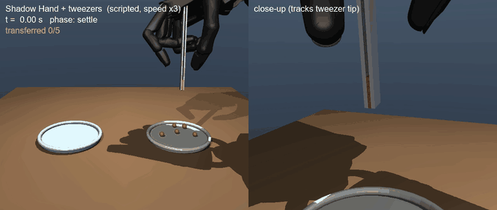

# robothand-sim: 5本指ハンド＋ピンセットによる豆の移し替え（MuJoCo）

5本指ロボットハンド（Shadow Hand）がピンセットを持ち、皿Aの炒り豆を1粒ずつ皿Bへ移すシミュレーションです。
第1回GMOロボットハンドコンテストの課題（5本指ハンド・ピンセットまたは箸・5分間で何粒移せるか）を、実機開発に入る前にシミュレーションで再現しました。



## 現在できること

- Shadow Hand（MuJoCo Menagerie 版、20アクチュエータ）が、親指と人差し指の腹でピンセットを開閉する
- スクリプト制御（学習なし）で、豆を連続して皿Aから皿Bへ移す
- 指の腹とピンセットの接触力を触覚センサーの代わりに使い、親指と人差し指の把持力をそれぞれ目標値に合わせる
- 豆の配置・大きさのばらつき・位置認識の誤差・先端の摩擦係数・動作速度を変えて、成功率と速度を測る

## 結果

すべて、開発中に一度も使っていない豆の配置（シード 200 以降）で測った値です。1つの配置につき豆5粒を続けて移します。括弧内は成功率の95%信頼区間です。

**速度**（摩擦係数 0.8、認識誤差なし）

| 速度倍率 | 成功率 | 1粒あたり | 5分換算 |
|---|---|---|---|
| 1× | 248/250 = 99%（97〜100%） | 4.35 秒 | 68 粒 |
| 2× | 100/100 = 100%（96〜100%） | 2.18 秒 | 138 粒 |
| 3× | 98/100 = 98%（93〜99%） | 1.45 秒 | 203 粒 |
| 4× | 0/100 = 0% | 1.09 秒 | 0 粒 |

3倍速までは成功率を保てますが、4倍速ではすべて失敗します。4倍速の失敗原因はまだ調べていません。

**豆の位置の認識誤差**（水平2軸それぞれに、標準偏差 σ のガウス誤差を加えた）

| σ | 1× | 3× |
|---|---|---|
| 0 mm | 100% | 98% |
| 1 mm | 100% | 99% |
| 2 mm | 98% | 96% |
| 3 mm | 91% | 86% |

各条件 100 回。画像から豆を検出するときの目標精度は、σ 2 mm 以内が目安になります。

**ピンセット先端の摩擦係数**（3倍速）

摩擦係数 0.1・0.2・0.3・0.5・0.8 のいずれでも、成功率は 98/100 で、結果は完全に同じでした。
摩擦係数が設定どおりに接触へ反映されていることは確認済みです。0.03 以下にすると、確認用の1配置で5粒すべて失敗しました。
このシミュレーションでは、豆を硬い球とし、把持力（指1本あたり 0.25 N）に十分な余裕があるため、摩擦係数 0.1 以上では差が出ません。
先端の材料（柔らかさ・接触面積・豆の表面のばらつき）の効果は、このモデルでは表現できていません。材料の工夫を提案に盛り込むなら、根拠はシミュレーション以外（実物の試験）で示す必要があります。

条件ごとの全データは [docs/results/](docs/results/) にあります。

## シミュレーションの構成

| 要素 | モデル化 |
|---|---|
| ハンド | Shadow Hand E3M5 右手（MuJoCo Menagerie）。中指・薬指・小指は握り込み、親指と人差し指でピンセットを操作 |
| 腕 | 3軸の直動ガントリー（位置サーボに速度・加速度のフィードフォワードを加える）。手首の2関節は拘束で固定 |
| ピンセット | 長さ125 mm。2枚の葉をそれぞれバネ付きヒンジで開く方向に支え、先端内側に摩擦パッド（16 mm）を付けた。根元は掌のホルダーに固定 |
| 豆 | 直径 8 mm ±1 mm の球、0.25 g 前後 |
| 皿 | 半径 50 mm、縁を一段高くした浅皿 |

ピンセットの取り付け位置は、ハンドの「親指と人差し指のピンチ姿勢」で両指の腹が接する点と、その接触法線から、モデル構築時に自動で計算します（`scene.calibrate_pinch`）。ピンチ姿勢を変えても、ピンセットが追従して付け直されます。

## 制御

1粒ごとに、次の段階を最小躍度軌道でつなぎます。

1. 豆の上へ移動
2. 下降（先端を豆の赤道より少し下へ。ただし皿面から 1.2 mm 以上離す）
3. 閉じる・保持（力制御）
4. 持ち上げる
5. 皿Bの上へ運ぶ
6. 下ろす
7. 開いて離す
8. 退避

閉じる動作は、指ごとに次の3段階で行います（ガード付き移動）。

1. 葉の先端が中心線から 7.5 mm より外にある間は、80 mm/s で速く閉じる
2. それより内側では 20 mm/s に落とす（先に触れた葉が軽い豆を弾き飛ばさないように）
3. 指の腹が葉に触れたら（0.03 N 以上）、指の腹から葉に加わる法線力を 0.25 N に保つ積分制御に切り替える

葉の位置はヒンジ角から求めています。2本の指は運動学が違うため、関節角の目標を同じだけ動かしても力がそろいません。位置制御だけでは、片方の葉が中心まで押し込まれ、豆が抜けました。

## 開発中に分かったこと（シミュレーション上の落とし穴）

実機に進む前に知っておく価値がある内容なので、記録しておきます。

1. **mocap（運動学的に位置を指定する物体）でハンドを動かすと、豆を持ち上げられない。** mocap は毎ステップ瞬間移動するため速度を持たず、接触の摩擦（速度レベルの拘束）が働かない。ピンセットは豆の横をすり抜ける。腕を直動関節と位置サーボに置き換えて解決した。
2. **軽い物体はソフト接触に沈み込む。** MuJoCo の拘束の正則化はおよそ 1/質量 に比例するため、0.25 g の豆を約 1 N で挟むと、既定の接触パラメータでは定常的な押し込みが数 cm に達し、葉が豆を貫通する。豆とパッドの接触を、ほぼ剛体の設定（`solimp` の dmax=0.9999）にした。
3. **腱で結合された指関節（J1+J2）の初期値の分け方で、指先の位置が変わる。** 実機と同じく中関節（J2）が先に曲がる規則にしたところ、キーフレームのピンチ姿勢を再現できた。
4. **小さい豆では、先端の角が皿に当たる。** 先端の高さを「豆の中心から一定量下」とだけ決めていたため、直径7 mmの豆では先端が皿を押し、豆が皿にめり込んで失敗した（開発用の配置で100回中3回）。皿面からの最小間隔を追加して解消した。
5. **速くすると、閉じる動作が間に合わない。** 最初の力制御は「力の誤差に比例して指を進める」だけだったため、接触前の指の速度が 30 mm/s しかなく、2倍速では葉が豆に届く前に持ち上げていた（成功率 0%）。接触前は一定速度で閉じる方式に変えた。
6. **速くすると、手首がしなる。** Shadow Hand の手首サーボは 5〜10 Nm と弱く、速い移動で手が振られ、先端が腕より 5〜8 cm 遅れた。この状態で閉じ始めると葉が豆の上に乗る。手首を固定した。
7. **速くすると、腕の推力が飽和する。** 腕の推力上限 200 N に対して、ピーク速度での減衰力だけで 500 N を超え、先端が目標より最大 13 cm 遅れた。上限を 1000 N にした（実機の腕の能力は未確認、下記「制約」）。

## 実行方法

```bash
# 依存（Python 3.12、MuJoCo 3.x）。uv を使う場合
uv sync
uv run python scripts/fetch_menagerie.py     # Shadow Hand のモデルを third_party/ に取得

uv run python scripts/transfer_beans.py -n 5 --video outputs/transfer_5_beans.mp4
uv run python scripts/view.py -n 5           # ビューアでリアルタイム表示
uv run python scripts/evaluate.py --name baseline --seed-offset 200 --seeds 50
uv run python scripts/evaluate.py --name speed --seed-offset 200 --speed 1 2 3 4
```

条件を振る評価は、Kaggle の CPU カーネル（4コア）を最大5本並列にして実行できます（ローカルとの一致は確認済み：同じ配置・同じ条件の100回で、選んだ豆と成否がすべて一致）。

```bash
uv run python kaggle/build_kernels.py --user <kaggle-username>   # outputs/kaggle_kernels/ に生成
for d in outputs/kaggle_kernels/*/; do kaggle kernels push -p "$d"; done
# 完了後
kaggle kernels output <user>/rh-eval-speed-a -p outputs/kaggle/rh-eval-speed-a
uv run python scripts/summarize.py --name speed outputs/kaggle/rh-eval-speed-*/eval_*.csv
```

GPUは不要です（CPU 4コアのPCで、実時間の約2倍の速さで計算できます）。

## 評価のルール

- 豆の配置シード 0〜99 は開発用で、失敗の調査や修正に使いました。シード 100〜199 は制御の初版の評価に使い、その結果を見て制御を直しました。報告している数値は、どちらにも使っていないシード 200 以降の配置で、最終版の制御を測ったものです。
- 成功の判定：搬送後に 0.5 秒置いて静止させ、豆の中心が皿Bの内側（半径 50 mm 以内かつ皿面から 20 mm 以内）にあること。
- 「5分あたりの粒数」は、`300 秒 ÷ 1粒あたりの秒数 × 成功率` で求めた参考値です。

## 制約（実機とのギャップ）

- **ピンセットの根元は掌に固定しています。** 指だけで工具を保持・持ち替えする動作は未実装です。
- **豆の位置は真値（またはノイズを加えた値）を使っています。** カメラ画像からの検出は未実装です。
- 腕は3軸の直動で、手首の向きは固定です。実機の G1 の腕の運動学とは異なります。
- **速度倍率を上げたときの腕の速度・加速度が、実機の腕で出せるかは確認していません。** 3倍速では、皿の間の移動でピーク速度は約 1.7 m/s、加速度は約 26 m/s² になります。
- 豆は球で近似しています。実際の炒り豆は楕円体で、表面の摩擦にもばらつきがあります。

## 次の段階

| 段階 | 内容 | 判定基準 |
|---|---|---|
| 1 | 指だけでピンセットを保持する（ホルダーなし）。中指・薬指で根元を支える把持 | ホルダーありと同等の成功率 |
| 2 | 俯瞰カメラ画像から豆を検出し、検出位置で動かす | 認識誤差込みで成功率 90% 以上 |
| 3 | スクリプト制御で集めたデモ（＋ノイズを加えた変種）から、ACT または Diffusion Policy で模倣学習する | スクリプト制御と同等の成功率で、より速い |
| 4 | 実機と同じ構成（G1-D のハンド、データ収集用グローブによる遠隔操作デモ）へ移行する | 実機で1粒移す |
| 5 | 指先・先端パッドの材料（摩擦係数・柔らかさ）を、シミュレーションでの感度分析に基づいて選ぶ | 実機での成功率と速度 |

## ライセンス

- このリポジトリのコード：未定（公開前に決める）
- Shadow Hand のモデル（`third_party/mujoco_menagerie`、取得スクリプトで入手）：Apache-2.0（Google DeepMind / Shadow Robot Company）
